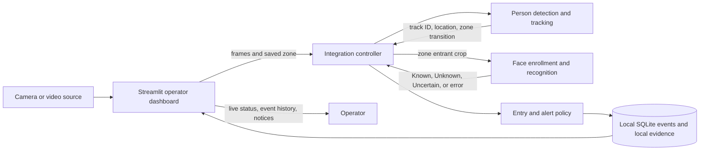

# Selective Smart Surveillance System

A local, zone-based monitoring application for a camera connected to a laptop. An operator defines a restricted area in the camera view. When a tracked person enters it, the system records one event, attempts to establish whether that person is enrolled, and shows the event in the dashboard.

The design separates camera interaction, detection, identity checks, event policy, storage, and presentation. Each part has a defined job and passes information through the integration layer. That structure lets the team work on separate modules, inspect failures at their source, and replace or improve one part without rewriting the whole application.

## Architecture at a glance



The dashboard is the operator interface; it does not own model or event logic. The controller coordinates the modules and gives every event a consistent path from camera input to storage and display. This keeps interface changes from becoming entangled with tracking, recognition, or database code.

## Why the project is structured this way

| Architecture choice | Reason |
| --- | --- |
| **Select by zone entry** | The system focuses face checks and event creation on people who cross an operator-defined boundary. This matches the project’s restricted-area goal and avoids treating every person in every frame as an alert. |
| **Track people across frames** | A track ID connects repeated observations of one person. The controller can associate a face result with the correct zone event and avoid creating a new event for every frame. |
| **Keep the controller between modules** | Detection, recognition, storage, and the dashboard can evolve behind a small integration surface. It also provides one place to manage the order of work and event lifecycle. |
| **Save an event before displaying its alert** | A dashboard refresh should not erase the record. SQLite keeps a local event history even when the operator is reviewing another dashboard section. |
| **Keep alerts local** | The intended demonstration is end to end on the laptop. There is no Telegram dependency or external notification service in the event path. |
| **Keep runtime data outside source control** | Face galleries, camera boundaries, event records, evidence, and model weights are machine-specific or sensitive. The code repository contains the application and setup guidance, not participant records. |
| **Use folders by responsibility** | Teammates can understand and commit changes in their module. Shared interfaces and dependencies are coordinated because they affect integration across the project. |

## Event lifecycle

1. The operator selects a laptop camera, supported phone-camera stream, or local video and draws a restricted zone on its view.
2. The controller passes frames through person detection and tracking, then checks the tracked person’s position against the zone.
3. On a new zone entry, the system creates one event record. It begins with identity pending, so an entry can be recorded even when the face is not visible at that moment.
4. While the person remains in the zone, the controller retries face checks at intervals, up to its configured attempt limit. A confirmed registered identity resolves a pending potential-intruder alert. Unknown or inconclusive results remain visible in the event history.
5. The dashboard displays the live state and stored events. Exiting the zone ends that tracked event’s active face-check lifecycle.

An alert means “the system has not yet confirmed this entrant as registered.” It is an operational prompt for review, not a claim that someone has harmful intent. A face-processing error should be treated as a system problem, not as an identity result.

## Components and ownership

| Component | Folder | Responsibility |
| --- | --- | --- |
| Operator dashboard | `src/selective_surveillance/dashboard/` | Camera controls, boundary editor, live preview, enrollment interface, event history, and notices |
| Detection and tracking | `src/selective_surveillance/detection/` | Find people, maintain track IDs, and report zone transitions |
| Facial recognition | `src/selective_surveillance/facial_recognition/` | Enrollment, face processing, gallery matching, and identity status |
| Integration controller | `src/selective_surveillance/integration/` | Coordinate frames, tracks, face checks, and the lifecycle of one entry event |
| Alert policy | `src/selective_surveillance/alerting/` | Decide when an entry needs a dashboard notice; no external messaging |
| Storage | `src/selective_surveillance/storage/` | Persist event history and associated local evidence |
| Shared records | `src/selective_surveillance/contracts.py` | Define data passed between modules |
| Evaluation | `evaluation/`, `tests/`, `notebooks/` | Scenario protocols, measured results, checks, and cell-by-cell experiments |

### Team work areas

| Teammate | Main work area |
| --- | --- |
| Williams Emehel | Detection and tracking |
| Emmanuel John | Facial recognition and enrollment |
| Abubakar Ahmed | Alert policy and storage |
| Ugochukwu Okoroji | Dashboard |
| Josiah Frank Achile | Integration and shared interfaces |
| Joseph Ekuma | Evaluation and scenario reporting |

Changes to shared records, configuration, dependencies, or module interfaces should be coordinated with the integration lead. Keep experiment code in Python notebooks; keep the runnable application in `src/`.

## Project supervision and institutional reference

**Project supervisors:** Stephen Ayuba and Rizama Victor. **Institutional reference:** [National Centre for Artificial Intelligence and Robotics (NCAIR)](https://ncair.nitda.gov.ng/), under Nigeria’s National Information Technology Development Agency (NITDA).

## Repository layout

```text
configs/                         Safe shared defaults and tracker configuration
docs/                            Architecture, interfaces, audit, privacy, and evaluation plans
evaluation/                      Scenario metrics and results
notebooks/                       Python notebooks for experiments and demonstrations
scripts/                         Setup and model download helpers
src/selective_surveillance/
  alerting/                      Local alert policy and service
  dashboard/                     Streamlit operator interface
  detection/                     Person detection and zone tracking
  facial_recognition/            Enrollment and identity matching
  integration/                   End-to-end event controller
  storage/                       Local event and evidence persistence
  contracts.py                   Shared module data records
tests/                           Automated project checks
```

## Run locally

Use Python 3.11, 3.12, or 3.13. From the repository root in PowerShell:

```powershell
$env:PROJECT_ENV = "$env:USERPROFILE\Documents\Codex\.venvs\surveillance"
python -m venv $env:PROJECT_ENV
& "$env:PROJECT_ENV\Scripts\Activate.ps1"
python -m pip install --upgrade pip
python -m pip install -e .
```

Put the required person detector weights in the local, ignored `models/` folder. The face models can be downloaded and checksum-verified with:

```powershell
python scripts/download_face_models.py
```

The detector weights are not included because their training-data and redistribution details were not supplied. Review [model provenance](docs/MODEL_PROVENANCE.md) before obtaining or sharing model files.

Start the dashboard on the laptop:

```powershell
python -m streamlit run src/selective_surveillance/dashboard/app.py --server.address 127.0.0.1 --server.port 8501
```

Connect a webcam or a phone running DroidCam through its PC client or a supported stream address. The documented PC connection methods are Wi-Fi and USB. Save a boundary for the selected camera, then start monitoring. For repeatable offline checks, use a local video file. A YouTube or Drive URL must first be downloaded to a video file on the laptop. Use `python -m pip install -e ".[dev]"` to add notebook and development dependencies.

## Runtime data and privacy

The application stores the face gallery, event database, evidence images, and zone settings in the operating system’s local application-data area. On Windows, the default is `%LOCALAPPDATA%\SelectiveSmartSurveillance`. Set `SELECTIVE_SURVEILLANCE_DATA_DIR` to choose another location. If the default location cannot be written, the app uses the ignored project-local `runtime_data/` folder.

Enroll only consenting participants. Do not commit face images, embeddings, event databases, camera stream addresses, local zone files, recordings, `.env` files, or model weights. Keep the dashboard bound to localhost for a student demonstration unless access control and a secure network deployment are configured. See [privacy and security notes](docs/PRIVACY_AND_SECURITY.md).

## Current limits

- Real camera accuracy, entry-to-notice delay, and sustained frame rate need to be measured on the demonstration laptop and camera; the repository does not claim measured performance without those results.
- The current face pipeline does not include liveness or anti-spoofing. Printed-photo, screen, and replay tests are evaluation scenarios, not protections currently provided by the system.
- Low-light enhancement can improve visible shadow detail but cannot recover identity detail that the camera did not capture.
- Face similarity is a comparison score, not the probability that two images show the same person. Thresholds and error rates must be reported with the chosen evaluation protocol.
- An identity match does not establish intent, authorization for every context, or whether a person is physically present rather than shown in a replay.

See [the project audit](docs/PROJECT_AUDIT.md), [module interfaces](docs/INTERFACES.md), and [scenario test plan](docs/TEST_PLAN.md) for implementation details and evaluation plans.
